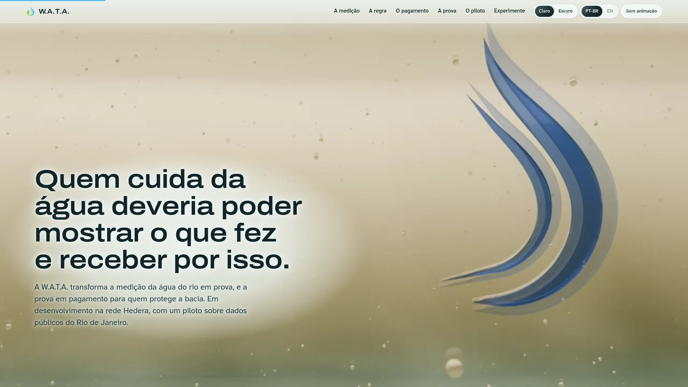
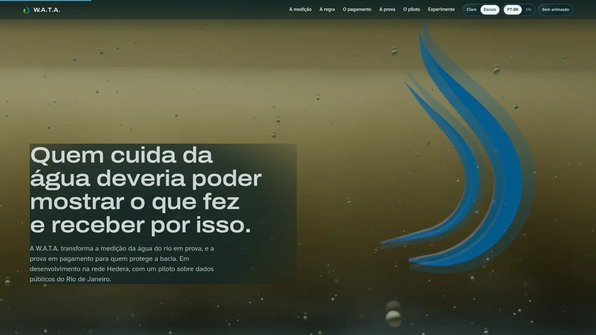
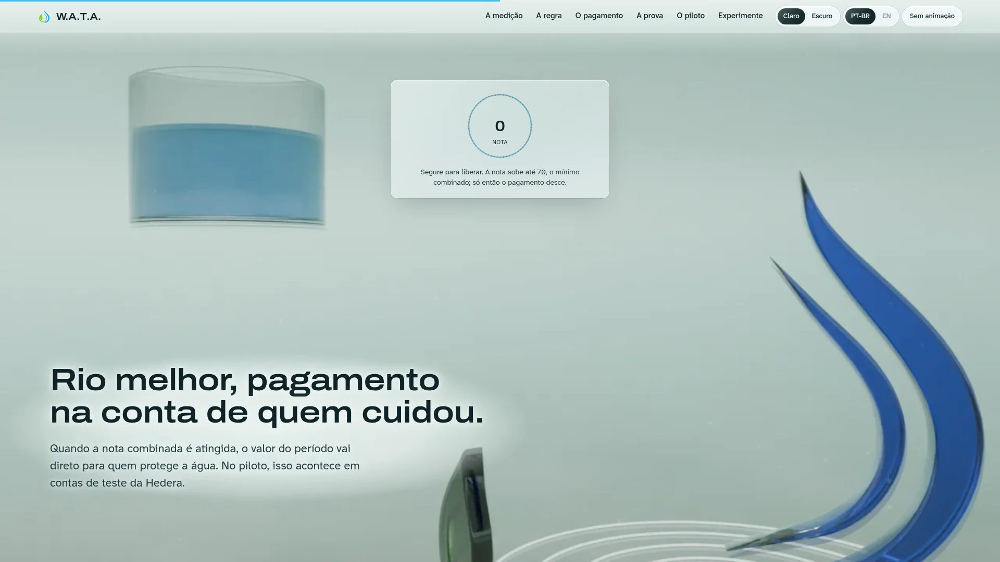
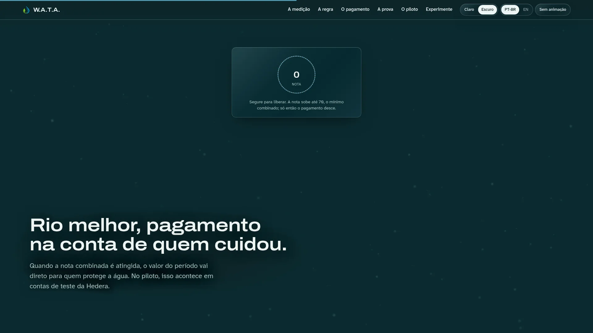
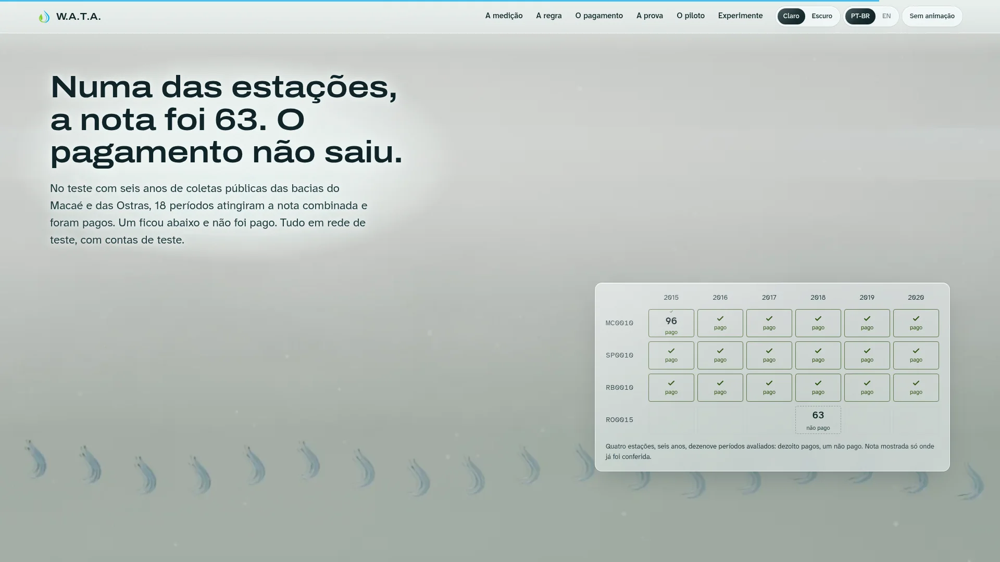
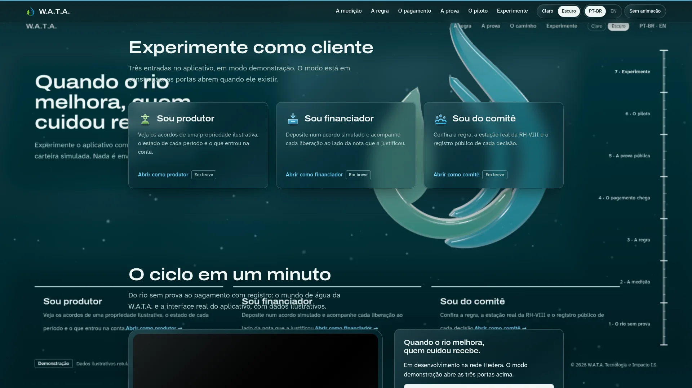
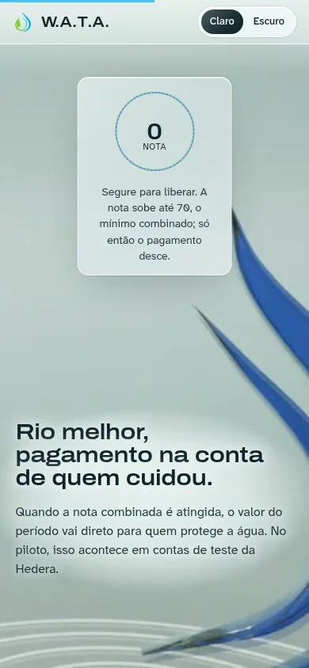
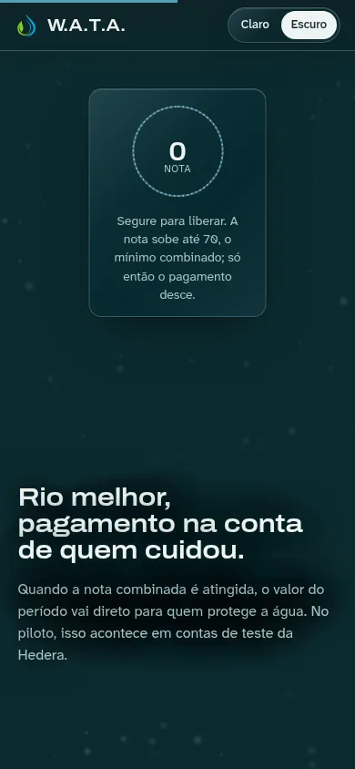
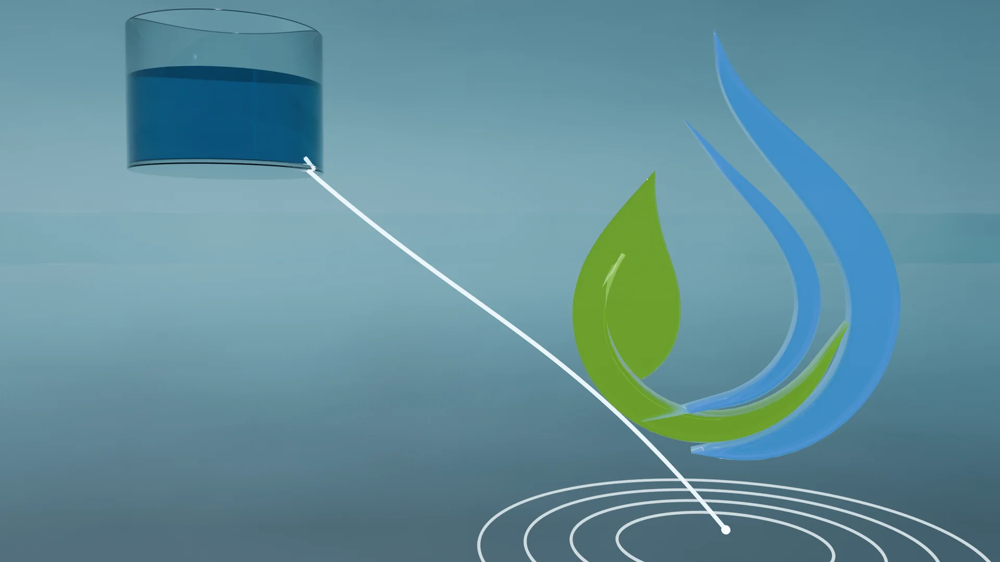

# W.A.T.A.

### Water Accountability and Transaction Automation

**Pagamento por serviço ambiental hídrico, com prova pública.**
Quem cuida da água deveria poder mostrar o que fez e receber por isso.

---

## O que é

A W.A.T.A. transforma a medição da água do rio em prova, e a prova em pagamento para quem protege a bacia.
A regra é combinada antes: quando a nota de qualidade da água atinge o mínimo acordado, o valor do período vai direto para a propriedade que cuidou. Cada decisão fica registrada em rede pública, para qualquer pessoa conferir.

<table>
  <tr>
    <td width="50%"></td>
    <td width="50%"></td>
  </tr>
  <tr>
    <td align="center"><b>O rio sem prova</b> · luz do dia</td>
    <td align="center"><b>O rio sem prova</b> · luz subaquática</td>
  </tr>
</table>

## Como funciona

| | Etapa | O que acontece |
|:-:|---|---|
| 💧 | **A medição** | Coletas públicas de qualidade da água, da estação mais próxima da propriedade. |
| 📐 | **A regra** | Um acordo define o limiar da nota e o valor por período, antes de qualquer pagamento. |
| ✋ | **O pagamento** | Nota atingida, o contrato libera o valor para quem protege a água. Abaixo do limiar, nada sai. |
| 🔎 | **A prova** | Nota, decisão e liberação ficam registradas e podem ser conferidas por qualquer pessoa. |

<table>
  <tr>
    <td width="50%"></td>
    <td width="50%"></td>
  </tr>
  <tr>
    <td colspan="2" align="center"><b>Segure para liberar</b>: a nota sobe até o mínimo combinado e só então o pagamento desce. A regra do contrato virando gesto.</td>
  </tr>
</table>

## O piloto

Um teste com seis anos de coletas públicas das bacias do Macaé e das Ostras, em rede de teste e com contas de teste.

## Experimente

O site leva ao app real em **modo demonstração**, com dados ilustrativos: nada é enviado, assinado ou cobrado.

| Perfil | Abrir |
|---|---|
| 🌱 Produtor rural | [app/demo/produtor](https://catitodev.github.io/wata-demosite/app/demo/produtor) |
| 💼 Financiador | [app/demo/financiador](https://catitodev.github.io/wata-demosite/app/demo/financiador) |
| 🏛️ Comitê de bacia | [app/demo/comite](https://catitodev.github.io/wata-demosite/app/demo/comite) |

## Em qualquer tela

Desenhado primeiro para o celular, em tema claro e escuro, com versão sem animação para quem prefere menos movimento.

  
  &nbsp;&nbsp;
  

## Fontes

- Qualidade da água: **INEA**, Região Hidrográfica VIII.
- Enquadramento: **CONAMA 357/2005**, classe 2.
- Foto do Rio Macaé: **Maclapessoa**, Wikimedia Commons, CC0.
- Tipografia: **Archivo** e **Atkinson Hyperlegible** (OFL).

---

© 2026 W.A.T.A. Tecnologia e Impacto I.S.

